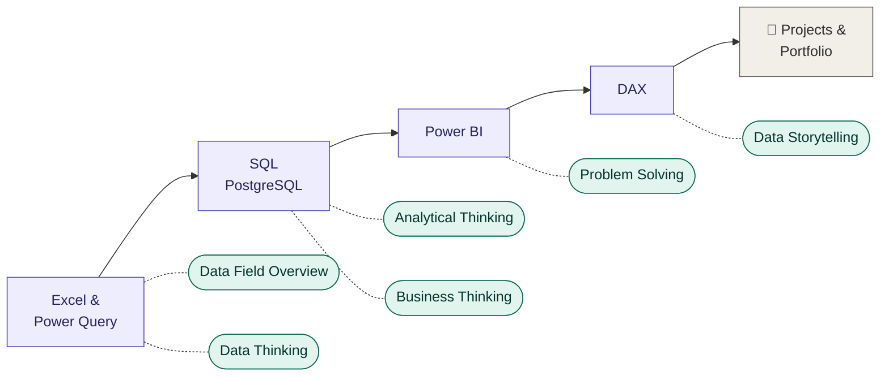

# 📊 Level 2: Data Analysis *(Track 1)*

[⬅ Previous: Beginner](../01-beginner/README.md) · [Back to overview](../README.md)

A structured learning path to become a Data Analyst, moving through data analysis tools and ending with practical projects and portfolio development.

> **Prerequisite:** [Level 1: Beginner](../01-beginner/README.md). Python, Statistics, and the Python data packages (NumPy, Pandas, Matplotlib, Seaborn, EDA, web scraping) are all covered there. This track focuses on the **data analysis tools**.
>
> **Going for ML / AI instead?** Skip this track and go to [Machine Learning](../03-machine-learning/README.md). SQL from this track is still **recommended** for you.

### 🧭 Learning Path

| Step | Tool session | Thinking session (alongside) |
|:--:|:--|:--|
| **1** | Excel & Power Query | Data Field Overview · Data Thinking |
| **2** | SQL - PostgreSQL | Analytical Thinking · Business Thinking |
| **3** | Power BI | Problem Solving |
| **4** | DAX | Data Storytelling |
| **5** | Projects & Portfolio | — |

------------------------------------------------------------------------

## 1. Roadmap

The route of this track: each tool stage, with the thinking sessions studied alongside it. *Python*, *Statistics*, the Python data packages, and *Web scraping* are covered in [Level 1: Beginner](../01-beginner/README.md).

> 🟪 Tool stage · 🟩 Thinking session

------------------------------------------------------------------------

## 2. Tool Learning Sessions

This section covers the technical tools and skills required for a Data Analyst. Each session includes Arabic and English learning resources and a clear learning objective.

| Session | Arabic Resources 🇪🇬 | English Resources 🇬🇧 | Learning Objectives |
|---|---|---|---|
| **Excel & Power Query** | [Excel Fundamentals](https://www.youtube.com/playlist?list=PLX7gALGQvxQMNbo5l17pbf9peUT6npncF)   [Excel for Data Analysis - Mohamed Al Assaal](https://www.youtube.com/playlist?list=PLXlHqMRg9lAbetpJy3ePXsN0sj9Zs-pvT)   [Power Query](https://www.youtube.com/playlist?list=PL5NlUYOM2iOioKHGTJKFkykyp1oudj4HC) | [Luke Barousse - Excel for Data Analytics](https://www.youtube.com/watch?v=pCJ15nGFgVg) | Work with spreadsheets, formulas, lookup functions, data cleaning, sorting, filtering, Pivot Tables, charts, and Power Query for importing and transforming data. |
| **SQL - PostgreSQL** | [akwad dev - تعلم SQL باستخدام PostgreSQL](https://www.youtube.com/playlist?list=PLvsVwFBrUFQplD5VLJEntt7DUHSV8Jjij) | [Alex The Analyst - PostgreSQL Series (Part 1)](https://www.youtube.com/watch?v=USOqNVz3gXQ)   [Alex The Analyst - PostgreSQL Series Code (GitHub)](https://github.com/AlexTheAnalyst/PostgresqlYouTubeSeries)   **No-install option:** [DataCamp - Associate Data Analyst in SQL](https://app.datacamp.com/learn/career-tracks/associate-data-analyst-in-sql) | Learn SQL from basic to advanced levels, including SELECT, filtering, aggregation, JOINs, subqueries, CTEs, window functions, and solving business questions using PostgreSQL. |
| **Power BI** | [Zanoon Lab - Power BI](https://www.youtube.com/@ZanoonLab/playlists)   [Fouad Zawadi - Power BI](https://www.youtube.com/@fzawadi/playlists) | [Alex The Analyst - Power BI Playlist](https://www.youtube.com/playlist?list=PLUaB-1hjhk8HqnmK0gQhfmIdCbxwoAoys)   [Alex - Full Power BI Project](https://www.youtube.com/watch?v=I0vQ_VLZTWg) | Import data, transform and clean it using Power Query, create data models and relationships, design interactive reports and dashboards, and communicate insights visually. |
| **DAX** | [Munthir Saffan - DAX](https://www.youtube.com/playlist?list=PLof3yw6ZFPFh6VZ7wlSH4D10kjy4Dteoc) | [Alex The Analyst - How to Use DAX in Power BI](https://www.youtube.com/watch?v=vcijg0gUXSg) | Learn calculated columns, measures, DAX functions, CALCULATE, SUMX, filter context, row context, time intelligence, and advanced calculations in Power BI. |
| **Projects & Portfolio** | [Sahm Academy - كورس تحليل البيانات عمليًا (Guided Projects)](https://www.youtube.com/watch?v=a8dy3NwsZa8) | [Alex The Analyst - Portfolio Projects](https://www.youtube.com/playlist?list=PLUaB-1hjhk8H48Pj32z4GZgGWyylqv85f)   [Baraa - SQL Projects](https://www.youtube.com/@DataWithBaraa) | Apply the acquired skills through real-world projects, document the analysis process, publish projects on GitHub, build a professional portfolio, and demonstrate practical analytical abilities. |

### SQL: Don't Want to Install PostgreSQL?

If you prefer not to install PostgreSQL and pgAdmin on your device, you can practice SQL directly in the browser using DataCamp's **Associate Data Analyst in SQL** track. It includes PostgreSQL-specific courses, and you can follow the YouTube resources above alongside it.

### SQL: Database Systems Comparison

PostgreSQL will be the primary database management system used throughout this roadmap.

It is also important to understand how PostgreSQL differs from other popular database systems.

**Recommended comparison video:**

- [Alex The Analyst - MySQL vs PostgreSQL vs Microsoft SQL Server](https://www.youtube.com/watch?v=Q7i6zxHVj2Q)

Topics to understand:

- SQL vs Database Management Systems (DBMS).
- PostgreSQL vs MySQL.
- PostgreSQL vs Microsoft SQL Server.
- SQL syntax differences and database-specific functions.
- Data types and auto-increment mechanisms.
- Database management tools.
- Basic performance and indexing differences.

**Important:** SQL is the query language, while PostgreSQL, MySQL, and Microsoft SQL Server are database management systems. The main practical focus of this roadmap is PostgreSQL. Other systems are studied for comparison and understanding.

------------------------------------------------------------------------

## 3. Thinking Sessions

Technical skills alone are not enough to become an effective Data Analyst. These sessions focus on developing the mindset needed to understand data, identify problems, connect analysis to business objectives, and communicate meaningful insights.

The sessions are listed in the same order they appear in the roadmap diagram, each one placed between two tool stages.

| Thinking Session | Main Objective | Arabic Resources 🇪🇬 | English Resources 🇬🇧 |
|---|---|---|---|
| **Data Field Overview** | Understand the data industry, its career paths, and the different roles and domains. Explore Data Analyst, Business Analyst, BI Analyst, Data Scientist, and Data Engineer roles. Understand domains such as Finance, Healthcare, Marketing, Sales, HR, and E-commerce. | [DataSkool - Data Analyst vs Data Engineer vs Data Scientist](https://www.youtube.com/watch?v=PVNsxafgpPo)   [Mohamed Ali - Business Analyst vs Data Analyst](https://www.youtube.com/watch?v=_TDiwiTJxYQ) | [Alex The Analyst - Data Analyst vs Business Analyst](https://www.youtube.com/watch?v=G4syHs3M82E) |
| **Data Thinking** | Understand data before analyzing it. Learn about numerical and categorical data, discrete and continuous variables, structured and unstructured data, data quality, missing values, bias, and the difference between correlation and causation. | | |
| **Analytical Thinking** | Develop the ability to break down complex questions, identify patterns, formulate hypotheses, distinguish relevant information, and approach problems logically instead of jumping directly to conclusions. | | |
| **Business Thinking** | Understand how businesses operate, how they generate revenue, manage costs, measure performance, and make decisions. Learn to translate business objectives into measurable KPIs and analytical questions. | | |
| **Problem Solving** | Learn how to define problems, investigate their root causes, break them into smaller questions, use Exploratory Data Analysis (EDA), evaluate possible solutions, and support conclusions with evidence. | | |
| **Data Storytelling** | Turn analytical results into clear and meaningful stories. Learn how to select appropriate visualizations, explain findings, highlight important insights, and present recommendations to stakeholders. | | |

### Additional Career Exploration

The Data Field Overview session should also cover the distinction between different analytical roles:

- **Data Analyst:** Uses data to identify trends, answer questions, and support decisions.
- **Business Analyst:** Focuses on business processes, requirements, problems, and improving business operations.
- **BI Analyst:** Focuses on reporting, dashboards, KPIs, and business intelligence.
- **Data Scientist:** Uses statistics, programming, and machine learning to build predictive and analytical models.
- **Data Engineer:** Builds and maintains data pipelines and infrastructure.

The goal is to understand how these roles overlap and differ, rather than assuming that they are interchangeable.

------------------------------------------------------------------------

## 4. Practical Learning Guidelines

- Follow the technical sessions in order, but practice continuously.
- Choose one primary resource for each tool instead of watching multiple courses covering the same material.
- Complete practical exercises after every major topic.
- Use PostgreSQL for all SQL practice and projects.
- Build at least one project after completing each major tool.
- Develop analytical and business thinking alongside technical learning.
- Document projects and publish them on GitHub.
- Focus on understanding concepts and solving real problems, not just completing videos.

**Final Goal:** Build the technical skills, analytical mindset, business understanding, and practical experience required to work as a professional Data Analyst.

------------------------------------------------------------------------

[⬅ Previous: Beginner](../01-beginner/README.md) · [Back to overview](../README.md)
