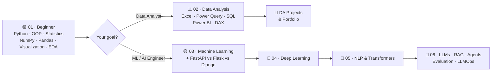

# AI Roadmap 2027

### A structured, project-driven path from zero to production AI: Beginner → Data Analysis **or** Machine Learning → Deep Learning → NLP → LLMs

> **Approach:** learn the concept, implement it, explain your decisions, and publish the result.
> Every stage pairs **Arabic 🇪🇬** and **English 🇬🇧** resources. Pick **one primary resource** per topic and use the other only when a concept isn't clear.

------------------------------------------------------------------------

## 🗺️ The Route



## 📚 Levels

| Level | Folder | Main focus | Exit project |
|:--|:--|:--|:--|
| 🟢 **Level 1 · Beginner** *(shared)* | [`01-beginner`](01-beginner/README.md) | Python, OOP, Statistics & Probability, Python data packages (NumPy, Pandas, cleaning, RegEx, Matplotlib, Seaborn, EDA) | EDA notebook |
| 📊 **Level 2 · Data Analysis** *(Track 1)* | [`02-data-analysis`](02-data-analysis/README.md) | Data analysis tools: Excel, Power Query, SQL (PostgreSQL), Power BI, DAX, Thinking sessions | DA portfolio projects |
| 🟡 **Level 3 · Machine Learning** *(Track 2)* | [`03-machine-learning`](03-machine-learning/README.md) | Math for ML, supervised, unsupervised, ensembles, intro to neural networks, **FastAPI vs Flask vs Django** | ML model served through an API |
| 🔴 **Level 4 · Deep Learning** *(Track 2)* | [`04-deep-learning`](04-deep-learning/README.md) | ANN training, CNN, transfer learning, XAI, autoencoders, GANs, RNN/LSTM, PyTorch basics | Transfer-learning image classifier |
| 🔴 **Level 5 · NLP & Transformers** *(Track 2)* | [`05-nlp-transformers`](05-nlp-transformers/README.md) | Classical NLP, embeddings, attention, Transformers, Hugging Face | Fine-tuned text classifier |
| 🔴 **Level 6 · LLM Engineering** *(Track 2)* | [`06-llm-engineering`](06-llm-engineering/README.md) | 5 phases: LLM foundations → RAG & context engineering → agents → evaluation → production (LLMOps) | A shipped, evaluated LLM application |

| Track | Path |
|:--|:--|
| 📊 **Data Analyst** | Beginner → Data Analysis |
| 🤖 **ML / AI Engineer** | Beginner → ML → DL → NLP → LLMs |

> **ML / AI learners:** you don't need the Data Analysis track. **SQL** (from [Data Analysis](02-data-analysis/README.md#2-tool-learning-sessions)) is still recommended, because most real data lives in databases.

------------------------------------------------------------------------

## 🗂️ Repository Structure

```text
ai-roadmap-2027/
├── README.md                      ← you are here (overview)
├── 01-beginner/README.md          ← Python, OOP, Statistics, Python data packages (shared)
├── 02-data-analysis/README.md     ← Level 2 · Track 1: DA tools + thinking sessions
├── 03-machine-learning/README.md  ← Level 3 · Track 2 starts: ML + FastAPI vs Flask vs Django
├── 04-deep-learning/README.md
├── 05-nlp-transformers/README.md
├── 06-llm-engineering/README.md   ← 5 phases: Foundations → RAG → Agents → Evaluation → Production
└── RESOURCES.md                   ← all main courses, books and channels in one place
```

------------------------------------------------------------------------

## ✅ How to Use This Roadmap

1. **Follow the sequence.** Later stages assume the skills from earlier ones. Move on when you can **apply** the skills, not merely when you finish a playlist.
2. **Choose one primary resource per topic.** Use alternatives only when you need another explanation.
3. **Practice continuously.** Reproduce examples, solve small exercises, and work with unfamiliar datasets.
4. **Build projects as you learn.** Don't postpone all practical work until the end.
5. **Keep evidence of your skills.** Publish clean GitHub repositories with clear READMEs, setup instructions, results, and limitations.
6. **Review by implementing**, not by rewatching the same videos.

> **About video numbers:** when this roadmap says *"Ahmed Yousry #20"* or *"Hesham Asem #4"*, the number is the video's **position in the playlist**, and every number is a direct link to that video.
