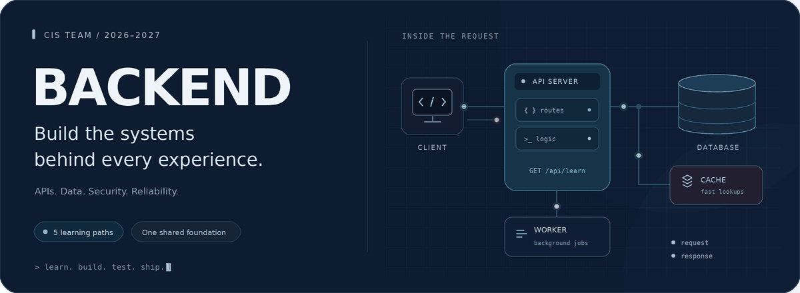
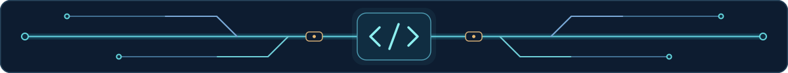
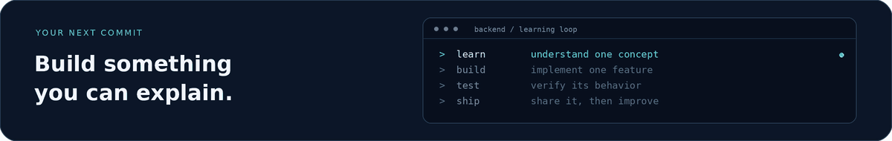

  <picture>
    <source media="(prefers-reduced-motion: reduce)" srcset="assets/backend-hero.svg" />
    
  </picture>

<h1 align="center">Backend Development</h1>

  <strong>CIS Team · 2026–2027</strong>
   
  Five learning paths. A shared foundation in building reliable software.

  
  
  
  
  

  <a href="#choose-your-path">Choose your path</a> ·
  <a href="#the-shared-foundation">Shared foundation</a> ·
  <a href="#build-as-you-learn">Projects</a> ·
  <a href="#official-documentation">Documentation</a> ·
  <a href="#contributing">Contribute</a>

## Behind every request

A login, a booking, a checkout, a message: each needs a system that applies the rules, protects data, and returns the right result. Backend development is the work that makes those interactions possible.

These mentor-curated roadmaps guide you through programming, databases, APIs, security, testing, and deployment. Choose a stack, understand the concepts behind its tools, and keep applying them in code.

> [!TIP]
> **Start with one path.** You do not need five frameworks to become a backend developer. Build confidence in one ecosystem, then explore others when you have a reason.

## Choose your path

Each path includes its own sequence and learning resources. Start with the language you already know, or choose one you want to use for your projects.

| Path | Language | What the roadmap covers | Start learning |
| --- | --- | --- | --- |
| **.NET** | C# | C# and OOP, SQL, LINQ, EF Core, ASP.NET Core, Identity, JWT, and deployment. | [Open .NET →](.NET/README.md) |
| **Node.js** | JavaScript / TypeScript | JavaScript, Node.js, SQL and MongoDB, Express, testing, security, and production engineering. NestJS is an optional framework path. | [Open Node.js →](Node/README.md) |
| **Spring** | Java | Core Java, JDBC, JPA/Hibernate, Spring Core, Spring Boot, REST APIs, security, Docker, and CI/CD. | [Open Spring →](Spring/README.md) |
| **Laravel** | PHP | PHP, MySQL, Eloquent, SOLID, design patterns, MVC, Laravel applications, and advanced backend topics. | [Open Laravel →](Laravel/laravel-roadmap/README.md) |
| **Django** | Python | Python and OOP, SQL, Django ORM, Django, REST Framework, testing, Redis, Channels, Celery, and deployment. | [Open Django →](Django/README.md) |

### Go straight to your stage

| Path | Get ready | Language foundations | Databases and persistence | Frameworks and beyond |
| --- | --- | --- | --- | --- |
| **.NET** | [Prerequisites](.NET/Prerequisites/README.md) | [Beginner](.NET/Beginner/README.md) | [Intermediate](.NET/Intermediate/README.md) | [Advanced](.NET/Advanced/README.md) |
| **Node.js** | [Entry](Node/README.md#21-entry-level) | [Beginner](Node/README.md#22-beginner-level) | [Intermediate](Node/README.md#23-intermediate-level) | [Advanced](Node/README.md#24-advanced-level) |
| **Spring** | [Basics](Spring/Basics/README.md) | [Beginner](Spring/Beginner/README.md) | [Intermediate](Spring/Intermediate/README.md) | [Advanced](Spring/Advanced/README.md) |
| **Laravel** | [Web and Git](Laravel/laravel-roadmap/beginner/README.md) | [Beginner](Laravel/laravel-roadmap/beginner/README.md) | [Intermediate](Laravel/laravel-roadmap/intermediate/README.md) | [Advanced](Laravel/laravel-roadmap/advanced/README.md) |
| **Django** | [Entry](Django/README.md#-entry) | [Beginner](Django/README.md#-beginner) | [Intermediate](Django/README.md#-intermediate) | [Advanced](Django/README.md#-advanced) |

Stage names, framework starting points, and time estimates follow each mentor's syllabus. Use the columns as a broad guide, follow your chosen roadmap, and agree on milestones with your mentor.

<strong>Not sure which one to choose?</strong>

- Already comfortable with **C#**? Start with .NET.
- Know **JavaScript**, or want to use **TypeScript**? Explore Node.js.
- Enjoy **Java** and want to work with its backend ecosystem? Explore Spring.
- Know **PHP**, or want to build with Laravel's conventions and tooling? Explore Laravel.
- Prefer **Python**, or already use it in your projects? Explore Django.

If you are new to programming, try a small exercise in one language and discuss the choice with your mentor. All five paths can teach the core skills; consistent practice will matter more than repeatedly switching stacks.

## The shared foundation

The tools change between stacks. These are the skills to keep building throughout your learning.

| Area | Understand | Show it in practice |
| --- | --- | --- |
| **The web** | Clients and servers, DNS, HTTP methods, status codes, headers, and JSON. | Trace a request and explain its response. |
| **Developer tools** | Git, branches, pull requests, the terminal, dependencies, and configuration. | Publish a project another person can set up and run. |
| **Programming and design** | Your language, collections, OOP where appropriate, error handling, and separation of concerns. | Implement a feature independently and explain your choices. |
| **Data** | Schema design, relationships, SQL, constraints, transactions, indexes, migrations, and ORM behavior. | Model a domain and keep its data consistent. |
| **APIs** | Routing, validation, authentication, authorization, pagination, and documentation. | Build an API with clear behavior for valid and invalid requests. |
| **Quality and security** | Meaningful tests, debugging, access control, password handling, and safe configuration. | Test a business rule, an unauthorized request, and an important failure case. |
| **Delivery and operations** | Deployment, logs, health checks, and the purpose of containers and CI/CD. | Run your application outside your development machine and investigate a failure. |

Start with a working application. Add caching, queues, real-time features, and more complex architecture when your roadmap or project gives you a concrete use for them.

## How to study

1. **Pick one primary resource per topic.** Use the alternatives when you need another explanation.
2. **Write code while learning.** Change the examples, break them, and work out why they fail.
3. **Finish a small deliverable.** A query, a test, a feature, or a short explanation makes progress visible.
4. **Build without the tutorial.** Recreate the idea from your own understanding before moving on.
5. **Review with your mentor.** Bring your code, questions, and the decisions you found difficult.
6. **Keep your work on GitHub.** Use clear commits and document how to run and test each project.

> [!NOTE]
> **Read the documentation for the version you use.** Course examples may use older framework APIs or configuration. Record your project versions and use the matching official documentation when something differs.

## Build as you learn

Work on projects throughout the roadmap. These examples are already included in the paths, so you can start from an existing brief or adapt the idea with your mentor.

| Path | Project progression | Open the material |
| --- | --- | --- |
| **.NET** | C# and SQL coding practice; weekly tasks and revision material are planned for gradual release. | [C# practice](.NET/Beginner/README.md#2-coding-practice) · [SQL practice](.NET/Intermediate/README.md#sql-practice) |
| **Node.js** | Database-layer project → deployed blog or task-manager API → e-commerce backend. | [Database project](Node/README.md#23-intermediate-level) · [API and production projects](Node/README.md#24-advanced-level) |
| **Spring** | Console library system → inventory management system → e-commerce REST API. | [Library](Spring/Projects/1-Beginner-Tasks/README.md) · [Inventory](Spring/Projects/2-Intermediate-Tasks/README.md) · [E-commerce](Spring/Projects/Advanced-Tasks/README.md) |
| **Laravel** | PHP and OOP exercises → database and Eloquent deliverables → MVC app with selected advanced features. | [Beginner](Laravel/laravel-roadmap/beginner/README.md) · [Intermediate](Laravel/laravel-roadmap/intermediate/README.md) · [Final project](Laravel/laravel-roadmap/advanced/README.md#final-project) |
| **Django** | Personal website → Python library CLI → blog with roles → URL shortener API with analytics. | [Entry project](Django/README.md#-entry) · [Python project](Django/README.md#-beginner) · [Blog](Django/README.md#-intermediate) · [API](Django/README.md#-advanced) |

### Before you call a project finished

- [ ] Its main business rules work, including important edge cases.
- [ ] Invalid input and unauthorized access receive appropriate responses.
- [ ] Important behavior has tests, and you can explain what those tests prove.
- [ ] Database setup and migrations are documented where applicable.
- [ ] Another developer can follow the README to run it.
- [ ] Configuration is explained and real secrets are excluded from Git.
- [ ] API requests and responses are documented where applicable.
- [ ] For a deployment-stage project, you can share a working deployment and find its logs.
- [ ] You can explain a design decision, a trade-off, and something you would improve.

**Bring evidence to a review:** your repository, a short demo, and a question worth discussing.

## Official documentation

Keep these references alongside your chosen courses. Select the documentation version that matches your project.

| Stack | Official starting point |
| --- | --- |
| **.NET** | [ASP.NET Core documentation](https://learn.microsoft.com/en-us/aspnet/core/) |
| **Node.js** | [Node.js Learn](https://nodejs.org/en/learn/getting-started/introduction-to-nodejs) · [Express](https://expressjs.com/) · [NestJS](https://docs.nestjs.com/) |
| **Spring** | [Spring guides](https://spring.io/guides) · [Spring Boot reference](https://docs.spring.io/spring-boot/index.html) |
| **Laravel** | [Laravel documentation](https://laravel.com/docs) |
| **Django** | [Django documentation](https://docs.djangoproject.com/en/stable/) · [Django REST Framework](https://www.django-rest-framework.org/) |

For shared concepts: [MDN HTTP](https://developer.mozilla.org/en-US/docs/Web/HTTP) · [Pro Git](https://git-scm.com/book/en/v2) · [PostgreSQL tutorial](https://www.postgresql.org/docs/current/tutorial.html) · [OWASP API Security](https://owasp.org/www-project-api-security/) · [Docker Get Started](https://docs.docker.com/get-started/).

### More from the mentors

- [Spring study and project guides](Spring/HELP/README.md)
- [Laravel roadmap PDF](Laravel/Laravel-Roadmap.pdf)
- [Laravel career preparation](Laravel/laravel-roadmap/career.md)
- [Node.js extra skills and references](Node/README.md#25-extra-skills--resources)
- [Django further learning](Django/README.md#-what-after-that)
- [.NET roadmap updates](.NET/README.md)

## Contributing

Help keep these paths useful by improving an explanation, replacing an outdated resource, fixing a link, or adding an exercise with a clear outcome.

1. Fork the repository and create a branch for your change.
2. Update the relevant path and check its links.
3. For a new resource, state what it teaches, its language, and whether it is free or paid. Include version information when relevant.
4. Open a pull request explaining what changed and how it helps learners.

For a proposed change to learning order or scope, explain the prerequisite it addresses and the practical outcome you expect. Discuss the change with the relevant mentor.

[Report an issue](https://github.com/CIS-Team/2026-2027-Roadmaps/issues) · [View pull requests](https://github.com/CIS-Team/2026-2027-Roadmaps/pulls) · [Explore all learning tracks](../README.md)

  <picture>
    <source media="(prefers-reduced-motion: reduce)" srcset="assets/backend-footer.svg" />
    
  </picture>

  <strong>Understand the request. Build the system. Own the result.</strong>
   
  Maintained by the CIS Team Backend mentors · 2026–2027

  <a href="#choose-your-path">Start your path</a> · <a href="../README.md">All tracks</a> · <a href="#top">Back to top ↑</a>

