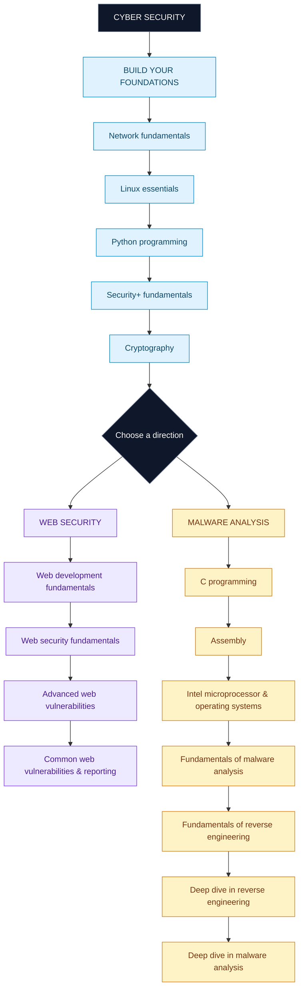

# Cyber Security Learning Map

Understand the systems beneath the surface, then explore how applications fail and how programs behave.

This map connects three learning paths: **Cybersecurity Entry**, **Web Security & Penetration Testing**, and **Malware Analysis**. Use it to find your starting point and open the detailed roadmap for its resources, labs, and tasks.

## The big picture

*The branches show different areas to explore, not a requirement to complete both. If you already know the foundations, start with the path that fits your background.*

---

## 01 · Foundations

Build familiarity with networks, operating systems, programming, and core security concepts.

| Sequence | Focus |
| :---: | --- |
| 1 | Network fundamentals |
| 2 | Linux essentials |
| 3 | Python programming |
| 4 | Security+ fundamentals |
| 5 | Cryptography |

**[Open the Cybersecurity Entry roadmap →](cyber-entry-roadmap.md)**

## 02 · Choose your specialization

### Web Security & Penetration Testing

Explore web technologies, vulnerability classes, practical labs, and reporting through a **16-week learning path**.

| Stage | Focus |
| --- | --- |
| **Month 1** | Web Development Fundamentals |
| **Month 2** | Web Security Fundamentals |
| **Month 3** | Advanced Web Vulnerabilities |
| **Month 4** | Common Web Vulnerabilities and Reporting |

The detailed roadmap includes weekly resources, PortSwigger labs, TryHackMe rooms, and tasks.

**[Open the Web Security roadmap →](penetration-testing-roadmap.md)**

### Malware Analysis

Study program behavior through programming, low-level systems, reverse engineering, and malware analysis.

| Sequence | Focus |
| :---: | --- |
| 1 | C programming |
| 2 | Assembly |
| 3 | Intel microprocessor & operating systems |
| 4 | Fundamentals of malware analysis |
| 5 | Fundamentals of reverse engineering |
| 6 | Deep dive in reverse engineering |
| 7 | Deep dive in malware analysis |

The detailed roadmap includes courses, books, and additional reference resources.

**[Open the Malware Analysis roadmap →](malware-analysis-roadmap.md)**

---

## How to use the map

**Locate your starting point → Open the detailed roadmap → Learn and practice → Revisit what needs work**

Follow the sequence inside your chosen roadmap. Use its resources and activities, keep notes on what you discover, and return to the foundations whenever you need them.

[← All learning tracks](../README.md)
