<a id="top"></a>

<p align="center">
  
</p>

<p align="center">
  
</p>

<p align="center">
  <em>Learning paths to help you find your direction, build new skills, and take your next step.</em>
</p>

<p align="center">
  
  
  
  
</p>

<p align="center">
  
  
  
</p>

<p align="center"></p>

<a id="prologue"></a>

## 🌅 Welcome to the Forest

There is no single right trail. Choose one that interests you, explore at your own pace, and build new skills along the way.

**CIS Team Roadmaps (2026 - 2027)** is your guide to that forest. It brings together learning tracks across technology, design, business, and digital media, so you can find your direction, stay consistent, and gain practical experience.

> **Not sure what to learn or where to start?**
>
> Each roadmap is a trail marker: a clear learning path covering essential topics, useful resources, and practical projects to guide your journey.

> [!TIP]
> **Our Golden Rule:**
> Learn the fundamentals, practice consistently, and apply what you learn.

<p align="center"></p>

<a id="map"></a>

## 🗺️ The Map of the Forest

Start with the map. **Five learning areas** bring together thirteen tracks. Choose an area below to explore its tracks.

<p align="center">
  
</p>

<p align="center">
  <a href="#chapter-1">Software Development</a> ·
  <a href="#chapter-2">Computer Science &amp; AI</a> ·
  <a href="#chapter-3">Infrastructure &amp; Cybersecurity</a><br/>
  <a href="#chapter-4">Design &amp; Creative Media</a> ·
  <a href="#chapter-5">Business &amp; Marketing</a>
</p>

### 🪧 Trail Signs

<div align="center">

**[🌲 Learning Tracks](#paths)** · **[🧭 Your Journey](#journey)** · **[🌱 Contribute](#contributing)** · **[🍂 Previous Season](#old-growth)** · **[🔥 Connect with Us](#campfire)**

</div>

<p align="center"></p>

<a id="paths"></a>

## 🌲 The Trails

Thirteen learning tracks, grouped into five areas, to help you choose where to start, explore new fields, and learn skills that work well together.

<a id="chapter-1"></a>

### Chapter I · The Builders’ Canopy

**Software Development**

> *In the canopy, builders connect the branches. Here, you can create websites, build the systems behind them, make mobile apps, or bring games to life.*

| Track                                                                                                                                                                                                                                                                  | What You'll Learn                                                                                  | Good For                                                                           |
| :--------------------------------------------------------------------------------------------------------------------------------------------------------------------------------------------------------------------------------------------------------------------- | :--------------------------------------------------------------------------------------------------------------- | :---------------------------------------------------------------------------------- |
| <a href="https://github.com/CIS-Team/2026-2027-Roadmaps/tree/main/Frontend"></a>      | Well-structured HTML, modern CSS, JavaScript/TypeScript, UI frameworks, web accessibility, and faster-loading pages.      | People who want to build interactive websites that work well on different screen sizes.         |
| <a href="https://github.com/CIS-Team/2026-2027-Roadmaps/tree/main/Backend"></a>        | REST APIs, SQL and NoSQL databases, user sign-in, caching, server-side system design, and testing.        | People who enjoy working with data and building systems that can grow.            |
| <a href="https://github.com/CIS-Team/2026-2027-Roadmaps/tree/main/Flutter"></a>      | Dart basics, Flutter widgets, state management, connecting to APIs, and publishing iOS and Android apps. | People who want to build iOS and Android apps from one codebase. |
| <a href="https://github.com/CIS-Team/2026-2027-Roadmaps/tree/main/Game%20Development"></a> | Game engines, physics, gameplay, C#/C++ programming, and building interactive 2D and 3D worlds.   | People who want to combine programming and storytelling to make games.      |

<p align="right"><a href="#map">🗺️ Back to the map</a></p>

<a id="chapter-2"></a>

### Chapter II · The Elder Grove

**Computer Science & Artificial Intelligence**

> *The oldest trees have deep roots. Build a strong foundation in computer science, or explore how data and AI help us find patterns and solve problems.*

| Track                                                                                                                                                                                                                                                                              | What You'll Learn                                                                                      | Good For                                                                                          |
| :-------------------------------------------------------------------------------------------------------------------------------------------------------------------------------------------------------------------------------------------------------------------------------------- | :------------------------------------------------------------------------------------------------------------------- | :------------------------------------------------------------------------------------------------- |
| <a href="https://github.com/CIS-Team/2026-2027-Roadmaps/tree/main/Computer%20Science"></a>                 | Different ways to structure programs, algorithms, data structures, problem-solving, operating systems, and networking.              | Learners who want to understand how computers work and how to solve problems with code.              |
| <a href="https://github.com/CIS-Team/2026-2027-Roadmaps/tree/main/AI%20%26%20Data%20Science"></a> | Python for data, statistics, machine learning, deep learning basics, and building AI systems. | People who enjoy finding patterns in data and using AI to solve problems or make predictions. |

<p align="right"><a href="#map">🗺️ Back to the map</a></p>

<a id="chapter-3"></a>

### Chapter III · The Riverwatch

**Infrastructure & Cybersecurity**

> *Along the river, some keep the water flowing while others guard the forest. Learn to run reliable systems in the cloud or protect them from attacks.*

| Track                                                                                                                                                                                                                                | What You'll Learn                                                                                    | Good For                                                                      |
| :----------------------------------------------------------------------------------------------------------------------------------------------------------------------------------------------------------------------------------- | :----------------------------------------------------------------------------------------------------------------- | :----------------------------------------------------------------------------- |
| <a href="https://github.com/CIS-Team/2026-2027-Roadmaps/tree/main/Cloud%20Computing"></a> | Cloud services, managing Linux systems, containers, automated testing and deployment (CI/CD), and running apps as demand grows. | People who want to automate tasks, keep systems reliable, and connect software development with operations (DevOps).    |
| <a href="https://github.com/CIS-Team/2026-2027-Roadmaps/tree/main/Cyber%20Security"></a>              | Protecting networks, finding website security weaknesses, cryptography, Linux security, and testing systems with permission.      | People who enjoy solving problems and protecting systems, networks, and data. |

<p align="right"><a href="#map">🗺️ Back to the map</a></p>

<a id="chapter-4"></a>

### Chapter IV · The Meadow of Colors

**Design & Creative Media**

> *The trees open onto a colorful meadow. Design easy-to-use products, create clear visuals, or tell stories through video.*

| Track                                                                                                                                                                                                                  | What You'll Learn                                                                                       | Good For                                                                                 |
| :--------------------------------------------------------------------------------------------------------------------------------------------------------------------------------------------------------------------- | :-------------------------------------------------------------------------------------------------------------------- | :---------------------------------------------------------------------------------------- |
| <a href="https://github.com/CIS-Team/2026-2027-Roadmaps/tree/main/UI%20-%20UX">          | User research, organizing content, wireframes, design systems, interactive prototypes, and testing how easy a product is to use. | People who want to understand users and design products that are easy to use. |
| <a href="https://github.com/CIS-Team/2026-2027-Roadmaps/tree/main/Graphic%20Design"> | Guiding attention through design, typography, color theory, layouts, and creating a consistent look for a brand.                  | People who enjoy sharing ideas through print and digital design.         |
| <a href="https://github.com/CIS-Team/2026-2027-Roadmaps/tree/main/Video%20Editing"></a>     | Editing clips, pacing, motion graphics, sound design, adjusting colors, and telling stories through video.                      | People who enjoy turning raw footage into videos that hold viewers' attention.             |

<p align="right"><a href="#map">🗺️ Back to the map</a></p>

<a id="chapter-5"></a>

### Chapter V · The Crossroads Village

**Business & Marketing**

> *All the trails meet in the village. Turn business goals into clear plans, or use content and marketing to reach people and grow a community.*

| Track                                                                                                                                                                                                                                                             | What You'll Learn                                                                           | Good For                                                                                 |
| :---------------------------------------------------------------------------------------------------------------------------------------------------------------------------------------------------------------------------------------------------------------- | :-------------------------------------------------------------------------------------------------------- | :---------------------------------------------------------------------------------------- |
| <a href="https://github.com/CIS-Team/2026-2027-Roadmaps/tree/main/Business%20Analysis"></a><br/><sub><i>📊 The Cartographer’s Hut</i></sub>  | Understanding business needs, mapping processes with BPMN diagrams, helping teams agree on goals, and using data to guide product decisions. | People who want to connect business needs with the teams building solutions. |
| <a href="https://github.com/CIS-Team/2026-2027-Roadmaps/tree/main/Marketing%20%26%20Content"></a><br/><sub><i>📣 The Bonfire Square</i></sub> | Digital marketing, planning content, copywriting, understanding audiences through data, and telling a brand's story.   | People who enjoy creating content and helping communities, products, and brands grow.                  |

<p align="right"><a href="#top">⬆ Back to the edge of the forest</a></p>

<p align="center"></p>

<a id="journey"></a>

## 🧭 Your Journey

Every journey is different. Use these steps as a flexible guide: start with the basics, practice, build projects, and keep growing at your own pace.

<p align="center">
  
</p>

> [!TIP]
> **Remember:** A roadmap is a guide, not a race. Follow it at your own pace, adapt it to your needs, and focus on understanding rather than simply completing topics.

<p align="center"></p>

<a id="contributing"></a>

## 🌱 Plant a Tree: Contribute

Learning is better when we build together. Help this forest grow by sharing what you know. Contributions are welcome from CIS Team members and anyone who wants to help.

```text
🌰 An idea → 🌱 An issue → 🌿 A pull request → 🌳 Merged!
```

You can contribute by:

- 🌰 Sharing useful learning resources.
- 🌿 Improving existing roadmaps and documentation.
- 🍂 Reporting outdated information or broken links.
- 🏗️ Adding practical exercises and project ideas.
- 🔭 Suggesting new topics and improvements.

### How to Contribute

1. 🍴 Fork the repository.
2. 🌿 Create a branch for your changes.
3. 🌳 Make and commit your improvements.
4. 🚀 Push your branch and open a Pull Request with a clear description of your changes.

**Every contribution helps make these roadmaps better for everyone.**

<details>
<summary>🍄 <em>A secret from the forest</em></summary>
<br/>

Help clear the path for the next learner. If something confused you, suggest a fix or report it so others can learn more easily.

</details>

<p align="center"></p>

<a id="old-growth"></a>

## 🍂 Old Growth: Previous Season

Looking for last season's roadmaps? Follow an earlier trail:

**[Explore CIS Team Roadmaps 2025–2026 →](https://github.com/CIS-Team/2025-2026-Roadmaps)**


<a id="campfire"></a>

## 🔥 Around the Campfire: Connect with Us

Pull up a log and stay a while. Follow our updates and meet the other travelers:

<p align="center">
<a href="https://cisteam.org"></a>
<a href="https://github.com/CIS-Team"></a>
<a href="https://discord.gg/gNyZGDnvna"></a>
<a href="https://linkedin.com/company/cisteam15"></a>
<a href="https://facebook.com/cisteam15"></a>
<a href="https://instagram.com/cisteam15"></a>
</p>

<p align="center">
  
</p>

<p align="center">
  <em>The trail does not end here. It begins the moment you take your first step.</em>
</p>

<p align="center">
  <strong>Start exploring. Your next step begins here.</strong>
</p>

<p align="center">
  <a href="#top">🌅 Back to the edge of the forest</a>
</p>

