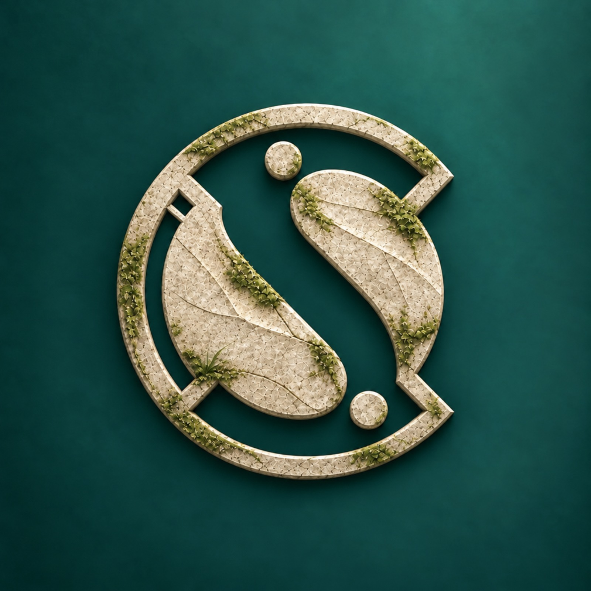

# CIS Team Roadmaps · 2026–2027

**Find your direction. Build your skills. Create something meaningful.**

[Explore the roadmaps](#roadmaps) · [Start learning](#getting-started) · [Connect with CIS](#connect)

---

## 🌿 A new season of learning

A collection of learning paths from **CIS Team**, bringing together topics, resources, and practical guidance across technology, design, and creativity.

Whether you are choosing your first field or exploring a new direction, start with what interests you and build from there. Each roadmap offers its own approach, giving you room to learn at a pace that works for you.

> **2026–2027 is taking shape.** Track folders are ready, and roadmaps will appear as they are published. You can explore the [2025–2026 collection](https://github.com/CIS-Team/2025-2026-Roadmaps) while you wait.

## 🧭 Explore the roadmaps

### Development & infrastructure

| Track | What you’ll explore |
| --- | --- |
| 🌐 **[Frontend](Frontend/README.md)** | Web interfaces, accessibility, and interactive experiences |
| ⚙️ **[Backend](Backend/README.md)** | APIs, databases, and server-side applications |
| 📱 **[Flutter](Flutter/README.md)** | Cross-platform applications and mobile experiences |
| ☁️ **[Cloud Computing](Cloud%20Computing/README.md)** | Cloud platforms, infrastructure, and deployment |
| 🎮 **[Game Development](Game%20Development/README.md)** | Game engines, mechanics, and playable worlds |

### Foundations, data & analysis

| Track | What you’ll explore |
| --- | --- |
| 💻 **[Computer Science](Computer%20Science/README.md)** | Programming, algorithms, data structures, and systems |
| 🤖 **[AI & Data Science](AI%20%26%20Data%20Science/README.md)** | Data analysis, machine learning, and intelligent systems |
| 🔐 **[Cyber Security](Cyber%20Security/README.md)** | Security foundations, defensive thinking, and ethical practice |
| 📊 **[Business Analysis](Business%20Analysis/README.md)** | Requirements, business processes, and problem solving |

### Design & creativity

| Track | What you’ll explore |
| --- | --- |
| 🎨 **[UI / UX](UI%20-%20UX/README.md)** | User research, interaction design, and product experiences |
| 🖌️ **[Graphic Design](Graphic%20Design/README.md)** | Visual communication, composition, and brand identity |
| 🎬 **[Video Editing](Video%20Editing/README.md)** | Editing, motion, and visual storytelling |
| 📣 **[Marketing & Content](Marketing%20%26%20Content/README.md)** | Strategy, storytelling, and connecting with audiences |

---

## 🚀 Make it your journey

**Choose a track → Learn the foundations → Put it into practice → Build and grow**

1. **Follow your curiosity.** Open a track and find a starting point that suits your experience.
2. **Take one step at a time.** Focus on understanding a topic before collecting more resources.
3. **Try what you learn.** Turn an idea into a small exercise, design, experiment, or project.
4. **Keep your progress visible.** Save your work, revisit what was difficult, and build on each small win.

*A roadmap gives you direction. Practice turns it into progress.*

## 📂 Find your way around

Each track has a **README** linking to its available roadmaps and resources. Paths may take different forms—written guides, visual maps, PDFs, or online documents.

Looking for earlier material? Visit **[CIS Team Roadmaps 2025–2026](https://github.com/CIS-Team/2025-2026-Roadmaps)**.  
Sharing a roadmap this season? The details are in the **[contribution guide](CONTRIBUTING.md)**.

---

### 🌍 Stay connected with CIS Team

[Website](https://cisteam.org) · [GitHub](https://github.com/CIS-Team) · [LinkedIn](https://linkedin.com/company/cisteam15) · [Facebook](https://facebook.com/cisteam15) · [Instagram](https://instagram.com/cisteam15)

**Learn · Build · Practice · Grow**

Made with 💚 by **CIS Team**  
*Share the path with someone taking their first step.*

