<a id="top"></a>

<p align="center">
  
</p>

<p align="center">
  
</p>

<p align="center">
  <em>Learning paths to help you find your direction, build new skills, and take your next step.</em>
</p>

<p align="center">
  
  
  
  
</p>

<p align="center">
  
  
  
</p>

<p align="center"></p>

<a id="prologue"></a>

## 🌅 Prologue: The Edge of the Forest

<p align="center">
  <em>It is early. Mist threads between the trunks, a bird is testing the first note of the day,<br/>
  and in front of you the path splits. Not once, but thirteen times.</em>
</p>

Nobody will tell you which trail is the right one, and that is the point. Every trail leads somewhere worth going, and every traveler who walks one comes out the other side as someone new.

**CIS Team Roadmaps (2026 - 2027)** is your guide to that forest. It brings together learning tracks across technology, design, business, and digital media, so you can find your direction, stay consistent, and gain practical experience.

> **Not sure what to learn or where to start?**
>
> Each roadmap is a trail marker: a clear learning path covering essential topics, useful resources, and practical projects to guide your journey.

> [!TIP]
> **Our Golden Rule:**
> Learn the fundamentals, practice consistently, and apply what you learn.

<p align="center"></p>

<a id="map"></a>

## 🗺️ The Map of the Forest

Before you step in, study the map. **Five regions** rise from a single trailhead, each home to its own trails. Find the one that calls to you.

<p align="center">
  
</p>

### 🪧 Trail Signs

<div align="center">

**[🌲 The Trails](#paths)** · **[🎒 Your Pack](#pack)** · **[🧭 Your Journey](#journey)** · **[📜 Laws of the Forest](#laws)** · **[🌱 Plant a Tree](#contributing)** · **[🍂 Old Growth](#old-growth)** · **[🔥 The Campfire](#campfire)**

</div>

<p align="center"></p>

<a id="paths"></a>

## 🌲 The Trails

Thirteen learning tracks, organized by region, so you can find your starting point, discover new fields, and develop complementary skills across disciplines.

<a id="chapter-1"></a>

### Chapter I · The Builders’ Canopy

<sub>**Software Development**</sub>

> *High above the forest floor, builders raise bridges of light between the branches. Some shape what travelers see, some tend what lies beneath the soil, some send seeds on the wind, and some light fireflies just to see who comes to play.*

| Track                                                                                                                                                                                                                                                                  | Focus Areas & Core Technologies                                                                                  | Ideal For                                                                           |
| :--------------------------------------------------------------------------------------------------------------------------------------------------------------------------------------------------------------------------------------------------------------------- | :--------------------------------------------------------------------------------------------------------------- | :---------------------------------------------------------------------------------- |
| <a href="https://github.com/CIS-Team/2026-2027-Roadmaps/tree/main/Frontend"></a><br/><sub><i>🖥️ The Sunlit Canopy</i></sub>      | Semantic HTML, modern CSS, JavaScript/TypeScript, component frameworks, web accessibility, and performance.      | Creators passionate about building interactive, responsive user interfaces.         |
| <a href="https://github.com/CIS-Team/2026-2027-Roadmaps/tree/main/Backend"></a><br/><sub><i>⚙️ The Deep Roots</i></sub>         | RESTful APIs, relational/NoSQL databases, authentication, caching, server-side architecture, and testing.        | Builders who enjoy system logic, data flow, and scalable infrastructure.            |
| <a href="https://github.com/CIS-Team/2026-2027-Roadmaps/tree/main/Flutter"></a><br/><sub><i>📱 The Windborne Seeds</i></sub>      | Dart fundamentals, cross-platform widget architecture, state management, API integration, and native deployment. | Developers aiming to build high-performance iOS and Android apps from one codebase. |
| <a href="https://github.com/CIS-Team/2026-2027-Roadmaps/tree/main/Game%20Development"></a><br/><sub><i>🎮 The Firefly Hollow</i></sub> | Game engines, physics simulations, gameplay mechanics, C#/C++ scripting, and interactive 2D/3D world-building.   | Creators who want to blend software engineering with interactive storytelling.      |

<p align="right"><a href="#map">🗺️ Back to the map</a></p>

<a id="chapter-2"></a>

### Chapter II · The Elder Grove

<sub>**Computer Science & Artificial Intelligence**</sub>

> *Here the oldest oaks stand, and their roots reach deeper than any trend. Beneath the leaf litter, a hidden network of mycelium carries messages between every tree, quietly learning the shape of the whole forest.*

| Track                                                                                                                                                                                                                                                                              | Focus Areas & Core Technologies                                                                                      | Ideal For                                                                                          |
| :-------------------------------------------------------------------------------------------------------------------------------------------------------------------------------------------------------------------------------------------------------------------------------------- | :------------------------------------------------------------------------------------------------------------------- | :------------------------------------------------------------------------------------------------- |
| <a href="https://github.com/CIS-Team/2026-2027-Roadmaps/tree/main/Computer%20Science"></a><br/><sub><i>🌳 The Elder Oak</i></sub>                   | Programming paradigms, algorithms, data structures, problem-solving, operating systems, and networking.              | Learners seeking a strong theoretical and algorithmic foundation in computer science.              |
| <a href="https://github.com/CIS-Team/2026-2027-Roadmaps/tree/main/AI%20%26%20Data%20Science"></a><br/><sub><i>🍄 The Mycelium Network</i></sub> | Python for data, statistical analysis, machine learning models, deep learning fundamentals, and intelligent systems. | Analytical thinkers interested in turning data into intelligent solutions and predictive insights. |

<p align="right"><a href="#map">🗺️ Back to the map</a></p>

<a id="chapter-3"></a>

### Chapter III · The Riverwatch

<sub>**Infrastructure & Cybersecurity**</sub>

> *Where the river bends, mist gathers above the canopy and watchtowers stand guard on the banks. Some keep the water flowing. Others keep the gate shut against whatever creeps out of the thorns.*

| Track                                                                                                                                                                                                                                | Focus Areas & Core Technologies                                                                                    | Ideal For                                                                      |
| :----------------------------------------------------------------------------------------------------------------------------------------------------------------------------------------------------------------------------------- | :----------------------------------------------------------------------------------------------------------------- | :----------------------------------------------------------------------------- |
| <a href="https://github.com/CIS-Team/2026-2027-Roadmaps/tree/main/Cloud%20Computing"></a><br/><sub><i>☁️ The Mist Above the Trees</i></sub> | Cloud service models, Linux administration, containerization, CI/CD pipelines, and scalable deployment operations. | Engineers interested in infrastructure automation, reliability, and DevOps.    |
| <a href="https://github.com/CIS-Team/2026-2027-Roadmaps/tree/main/Cyber%20Security"></a><br/><sub><i>🛡️ The Thorn Gate</i></sub>                | Network defense, web vulnerability assessment, cryptography, Linux security, and ethical penetration testing.      | Problem-solvers dedicated to protecting systems, networks, and digital assets. |

<p align="right"><a href="#map">🗺️ Back to the map</a></p>

<a id="chapter-4"></a>

### Chapter IV · The Meadow of Colors

<sub>**Design & Creative Media**</sub>

> *The trees part and the light pours in. Wildflowers of every color lean toward the sun, a river carries lanterns downstream, and someone is already drawing the path the next traveler will follow.*

| Track                                                                                                                                                                                                                  | Focus Areas & Core Technologies                                                                                       | Ideal For                                                                                 |
| :--------------------------------------------------------------------------------------------------------------------------------------------------------------------------------------------------------------------- | :-------------------------------------------------------------------------------------------------------------------- | :---------------------------------------------------------------------------------------- |
| <a href="https://github.com/CIS-Team/2026-2027-Roadmaps/tree/main/UI%20-%20UX"></a><br/><sub><i>🧭 The Trailmakers</i></sub>              | User research, information architecture, wireframing, design systems, interactive prototyping, and usability testing. | Empathetic problem-solvers who want to design intuitive, human-centered digital products. |
| <a href="https://github.com/CIS-Team/2026-2027-Roadmaps/tree/main/Graphic%20Design"></a><br/><sub><i>🎨 The Wildflower Meadow</i></sub> | Visual hierarchy, typography, color theory, layout composition, and cohesive brand identity systems.                  | Visual communicators interested in creating compelling print and digital designs.         |
| <a href="https://github.com/CIS-Team/2026-2027-Roadmaps/tree/main/Video%20Editing"></a><br/><sub><i>🎬 The Lantern River</i></sub>        | Timeline editing, pacing, motion graphics, sound design, color grading, and visual storytelling.                      | Storytellers who enjoy transforming raw footage into engaging visual content.             |

<p align="right"><a href="#map">🗺️ Back to the map</a></p>

<a id="chapter-5"></a>

### Chapter V · The Crossroads Village

<sub>**Business & Marketing**</sub>

> *Smoke curls from chimneys where all the trails finally meet. In the cartographer’s hut, goals are turned into plans. In the square, around the bonfire, stories travel farther than any road.*

| Track                                                                                                                                                                                                                                                             | Focus Areas & Core Technologies                                                                           | Ideal For                                                                                 |
| :---------------------------------------------------------------------------------------------------------------------------------------------------------------------------------------------------------------------------------------------------------------- | :-------------------------------------------------------------------------------------------------------- | :---------------------------------------------------------------------------------------- |
| <a href="https://github.com/CIS-Team/2026-2027-Roadmaps/tree/main/Business%20Analysis"></a><br/><sub><i>📊 The Cartographer’s Hut</i></sub>  | Requirements engineering, BPMN process modeling, stakeholder alignment, and data-driven product strategy. | Strategic thinkers who enjoy bridging the gap between business goals and technical teams. |
| <a href="https://github.com/CIS-Team/2026-2027-Roadmaps/tree/main/Marketing%20%26%20Content"></a><br/><sub><i>📣 The Bonfire Square</i></sub> | Digital growth strategy, content architecture, copywriting, audience analytics, and brand storytelling.   | Communicators focused on growing communities, products, and brand reach.                  |

<p align="right"><a href="#top">⬆ Back to the edge of the forest</a></p>

<p align="center"></p>

<a id="pack"></a>

## 🎒 Your Pack for the Journey

Every trail comes with a pack. Roadmaps may include the following to support your learning:

| Component                    | What It Covers                                                                  |
| ---------------------------- | ------------------------------------------------------------------------------- |
| 🧭 **Track Overview**        | An introduction to the field, its main areas, and the skills you'll develop.    |
| 🪜 **Learning Topics**       | Core concepts and skills organized into a structured learning sequence.         |
| 🥾 **Prerequisites**         | Recommended background knowledge or skills to help you get started.             |
| 📚 **Learning Resources**    | Curated courses, tutorials, documentation, books, and other learning materials. |
| 🧰 **Tools & Technologies**  | Common tools, technologies, and frameworks used in the field.                   |
| 🔨 **Practical Exercises**   | Hands-on tasks to reinforce concepts and strengthen your skills.                |
| 🏗️ **Project Ideas**         | Practical projects that help you apply what you have learned.                   |
| 🔭 **Further Learning**      | Additional concepts and advanced topics to explore as you progress.             |

_The content and structure may vary across tracks to reflect the scope and learning needs of each field._

<p align="center"></p>

<a id="journey"></a>

## 🧭 Your Journey

Every journey is different. These steps are a flexible direction to help you build knowledge, gain practical experience, and grow in your chosen field, from the first seed to a tree of your own.

<p align="center">
  
</p>

> [!TIP]
> **Remember:** A roadmap is a guide, not a race. Follow it at your own pace, adapt it to your needs, and focus on understanding rather than simply completing topics.

<p align="center"></p>

<a id="laws"></a>

## 📜 The Laws of the Forest

We believe meaningful learning goes beyond completing courses. It's about understanding concepts, thinking independently, and applying knowledge through consistent practice.

| Principle      | What It Means                                                    | In the Forest                                    |
| :------------- | :--------------------------------------------------------------- | :----------------------------------------------- |
| **Understand** | Focus on why concepts work, not just how to use them.            | 🌱 *Deep roots hold the tallest trees.*          |
| **Practice**   | Strengthen your skills through hands-on experience.              | 💧 *Water a little, every day.*                  |
| **Explore**    | Stay curious and develop independent problem-solving abilities.  | 🧭 *Wander off the path, but carry a compass.*   |
| **Build**      | Turn your knowledge into practical projects.                     | 🏕️ *A shelter beats a daydream.*                 |
| **Improve**    | Learn from feedback and mistakes, and keep refining your skills. | ✂️ *Prune what hurts, keep what grows.*          |

<p align="center"></p>

<a id="contributing"></a>

## 🌱 Plant a Tree

Learning is better when we build together. A forest is only a forest because many hands planted it, and we welcome contributions from CIS Team members and the wider community.

```text
   🌰  ─────▶  🌱  ─────▶  🌿  ─────▶  🌳
  an idea    an issue     a PR      merged!
```

You can contribute by:

- 🌰 Sharing useful learning resources.
- 🌿 Improving existing roadmaps and documentation.
- 🍂 Reporting outdated information or broken links.
- 🏗️ Adding practical exercises and project ideas.
- 🔭 Suggesting new topics and improvements.

#### How to Contribute

1. 🍴 Fork the repository.
2. 🌿 Create a branch for your changes.
3. 🌳 Make and commit your improvements.
4. 🚀 Push your branch and open a Pull Request with a clear description of your changes.

**Every contribution helps make these roadmaps better for everyone.**

<details>
<summary>🍄 <em>A secret from the forest</em></summary>
<br/>

The best trail in this forest is the one you help clear for the next traveler. If you found something that confused you, fix it here, and you will have made the woods a little kinder for someone you will never meet.

</details>

<p align="center"></p>

<a id="old-growth"></a>

## 🍂 Old Growth: Previous Season

Every forest has ground that was walked before. Looking for the previous edition?

**[Explore CIS Team Roadmaps 2025–2026 →](https://github.com/CIS-Team/2025-2026-Roadmaps)**

<p align="center"></p>

<a id="campfire"></a>

## 🔥 Around the Campfire

Pull up a log and stay a while. Follow our updates and meet the other travelers:

<p align="center">
<a href="https://cisteam.org"></a>
<a href="https://github.com/CIS-Team"></a>
<a href="https://discord.gg/gNyZGDnvna"></a>
<a href="https://linkedin.com/company/cisteam15"></a>
<a href="https://facebook.com/cisteam15"></a>
<a href="https://instagram.com/cisteam15"></a>
</p>

<p align="center"></p>

<p align="center">
  
</p>

<p align="center">
  <em>The trail does not end here. It begins the moment you take your first step.</em>
</p>

<p align="center">
  <strong>Start exploring. Your next step begins here.</strong>
</p>

<p align="center">
  <a href="#top">🌅 Back to the edge of the forest</a>
</p>


